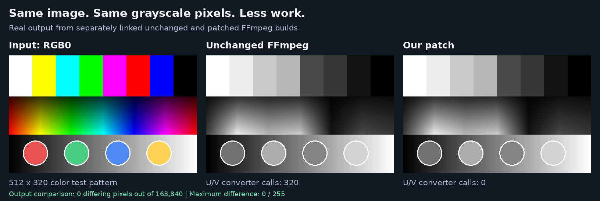

# Speed of the displayed RGB0 example

The same 512 × 320 RGB0 test image was converted to GRAY8 with each build.



The instrumented, untimed comparison found **0 differing pixels out of
163,840**. The unchanged build invoked the input U/V converter **320 times**;
the patched build invoked it **zero times**. Pixel hashes and callback counts
are recorded in `results.json`, `unchanged.json` and `patched.json`.
The timing program is separate and has no callback instrumentation.

| Build | Median conversion time |
|---|---:|
| Unchanged | 0.338 ms/frame |
| Patched | 0.247 ms/frame |

The ratio of medians gives **27.0% less conversion time**, equivalent to **37.1% higher conversion throughput**.

Method: 9 alternating pairs (9 samples per build), 4,800 timed conversions per sample after 500 warmup conversions, pinned to CPU 2 on the 12th Gen Intel(R) Core(TM) i7-12800H. Both executables use identical harness compiler options and the previously paired static FFmpeg builds. Native CPU dispatch, one thread, BT.709, full range, SWS_BILINEAR; the exact same input buffer is reused. Only sws_scale is timed: initialization, allocation, file I/O, callback instrumentation and output checking are excluded. Measured sample durations span 1.10–2.17 seconds.

Every sample's final output was byte-for-byte identical to the previously displayed output. No production source or PR was changed.

The current power settings were retained (powersave governor, energy preference power); clocks were not fixed and the CPU was not exclusively reserved. Individual paired time reductions ranged from 20.8% to 42.0%. These are local conversion timings, not end-to-end video-pipeline timings or cross-platform estimates.

An initial shorter-sample pass is retained in benchmark-first-pass.json. Its median time reduction was 27.7%; substantial variation prompted the longer final run. Raw final samples, hashes and settings are in benchmark-results.json; benchmark.c and benchmark.py reproduce the measurement.

## Files and provenance

`source.rgb0` is the exact input used in both comparisons and timing; the
ignored fourth byte varies deliberately. `source.png`, `unchanged.png` and
`patched.png` display the source and output, and the corresponding `.pgm`
files contain the packed grayscale output. `difference.png` is the absolute
pixel difference (all black). `render.py` generated the synthetic test card
and comparison graphic using Pillow; both grayscale images came from FFmpeg.

The saved baseline/patched static libraries from the earlier native
validation were reused, with matching build options. The baseline validation
started at `7afbfcbd92d6a73686a86416c1ade94bfc670d07`; the proposal was
subsequently rebased to `cc583787bbecd4914fee7c2bf7f09463113822fe`.
The C/header/assembly sources in libswscale match between those bases;
the grayscale guard is the relevant difference in the patched version.
Historical library hashes and original local artifact paths are retained in
`benchmark-results.json`. No separate fix for the unrelated odd-width
converter issue was used in this example.

## Reproduce on x86 Linux

Prepare baseline and patched FFmpeg source/build trees with identical
compiler/configure options, saving their static `libswscale.a` and
`libavutil.a` files. For the recorded pair, configure enabled avutil and
swscale, disabled the other libraries/programs/autodetection, and enabled
external x86 assembly. Set the following paths to those configured trees,
then run these commands from this directory. For an out-of-tree FFmpeg
build, also add the corresponding source include directory to each compile.

```sh
baseline_build=/absolute/path/to/unchanged-ffmpeg-build
patched_build=/absolute/path/to/patched-ffmpeg-build

cc -std=c17 -O2 -I"$baseline_build" benchmark.c \
  "$baseline_build/libswscale/libswscale.a" \
  "$baseline_build/libavutil/libavutil.a" -lm -pthread -o /tmp/gray-bench-unchanged
cc -std=c17 -O2 -I"$patched_build" benchmark.c \
  "$patched_build/libswscale/libswscale.a" \
  "$patched_build/libavutil/libavutil.a" -lm -pthread -o /tmp/gray-bench-patched

python3 benchmark.py /tmp/gray-bench-unchanged /tmp/gray-bench-patched \
  --cpu 2 --trials 9 --iterations 4800 --output /tmp/gray-benchmark-reproduced.json
```

Choose an allowed CPU for the target system. The Python runner uses Linux
`taskset`; it writes new measurements to the selected output path and leaves
the published JSON unchanged. Every final output must match the committed
PGM example. This published-byte check is intended for the documented
source/build pair; other targets or dispatch modes may have different
rounding, so cross-platform checks should compare baseline and patched
outputs on the same target instead of using the committed x86 bytes.

To repeat the untimed callback count, compile `convert.c` twice in the same
way (it additionally requires matching internal headers). Each executable
takes `source.rgb0` and an output PGM path as its two arguments and prints
the callback count as JSON. Compare their PGM files with `cmp`.

`render.py input` recreates the deterministic source PNG and raw input;
`render.py compare` recreates the comparison images and `results.json` from
the two PGM files and callback-count JSON files. It requires Pillow and the
DejaVu Sans fonts at `/usr/share/fonts/TTF/` as used for the published graphic.

The standalone diagnostic sources are LGPL-2.1-or-later, as described in the
parent validation README.
